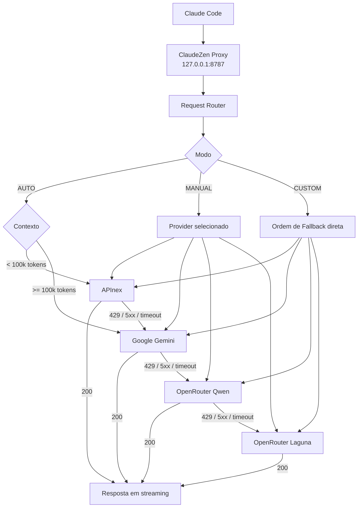

# ClaudeZen Hybrid Router

Proxy local para Claude Code com **roteamento híbrido entre múltiplos provedores de IA**, modos flexíveis (`AUTO`, `MANUAL` e `CUSTOM`), fallback automático, seleção manual de provider, cooldown, streaming em tempo real e **observabilidade por requisição** (estimativa local × uso real informado pelo provedor).

O Claude Code conversa somente com:

```text
http://127.0.0.1:8787
```

O ClaudeZen decide internamente qual provider e qual modelo serão utilizados.

> **Status do projeto: em desenvolvimento ativo.** A versão atual está operacional (AUTO, MANUAL, CUSTOM, fallback, cooldown, streaming e observabilidade) e já suporta **vários providers por plataforma** (por exemplo, dois modelos do OpenRouter — Qwen e Laguna — como contingências independentes). A configuração genérica, a validação na inicialização, o painel `/admin` com abas horizontais e grid responsivo, o switcher e os testes automatizados (100 testes) cobrem a entrega da API, integridade e segurança (a validação visual do layout no navegador é manual). Permanece pendente o teste com **falha real** de um provedor. Detalhes na [seção 20 do relatório técnico](RELATORIO.md#20-pontos-a-melhorar-em-desenvolvimento).

---

## Arquitetura



---

# Características

* [x] Proxy local para Claude Code
* [x] Roteamento automático (AUTO), manual (MANUAL) e por ordem direta (CUSTOM)
* [x] APInex, Google Gemini e dois modelos do OpenRouter (Qwen e Laguna)
* [x] Configuração genérica: vários providers da mesma plataforma
* [x] Validação da configuração na inicialização
* [x] Painel visual `/admin` com abas (Providers, Roteamento, Ordem de Fallback) e grid responsivo
* [x] API administrativa local em `/admin/api` com autenticação por token
* [x] Menu do switcher dinâmico (gerado a partir do config.json)
* [x] Testes automatizados (100 testes via `node --test`)
* [x] Fallback automático em cadeia
* [x] Cooldown por provider
* [x] Timeout por provider
* [x] **Streaming em tempo real** (sem bufferizar a resposta)
* [x] **Cancelamento propagado**: se o Claude Code desconectar, o upstream é abortado
* [x] **Observabilidade por requisição**: contexto, tools, roteamento, usage, tempo
* [x] **Uso real do upstream** comparado com a estimativa local
* [x] Banner de inicialização com checagem das API keys
* [x] Endpoint de status (`/router/status`)
* [x] Compatibilidade com a infraestrutura original do ClaudeZen
* [x] Zero dependências adicionais

---

# Providers

## APInex

```text
Base URL:
https://api.apinex.bond/v1

Modelo:
free/mimo-v2.6-pro
```

Provider principal no modo AUTO.

## Google Gemini

```text
Base URL:
https://generativelanguage.googleapis.com/v1beta/openai

Modelo:
gemini-3.8-flash
```

Usado preferencialmente para contextos grandes e como primeiro fallback.

## OpenRouter Qwen

```text
Base URL:
https://openrouter.ai/api/v1

Modelo:
qwen/qwen3.8-27b:free
```

Provedor de reserva no OpenRouter.

## OpenRouter Laguna

```text
Base URL:
https://openrouter.ai/api/v1

Modelo:
poolside/laguna-s-2.1:free
```

Provedor de reserva no OpenRouter, após o Qwen.

> Dois providers do OpenRouter compartilham o mesmo `baseUrl`, mas são entidades independentes: cada um tem `model`, `apiKeyEnv`, `name` e posição própria no `fallbackOrder`. O router os identifica pelo **ID** (`providers[id]`), não pela URL. Chaves diferentes da mesma conta podem compartilhar o limite dos modelos gratuitos do OpenRouter.

> Quer adicionar outro provider ou modelo? Veja [Como adicionar um novo provider ou modelo](#como-adicionar-um-novo-provider-ou-modelo).

---

## Como adicionar um novo provider ou modelo

Use este guia quando precisar:

- **Trocar ou adicionar uma IA de outra plataforma** (ex.: adicionar um provider da Together.ai).
- **Adicionar outro modelo de uma plataforma que já existe** (ex.: um terceiro modelo do OpenRouter).

Em ambos os casos, é um **novo provider independente**, com ID, `model` e `apiKeyEnv` próprios. Apenas o `baseUrl` pode se repetir (como acontece com os dois providers do OpenRouter).

### Requisito de compatibilidade

O ClaudeZen envia uma requisição **POST** para `{baseUrl}/chat/completions` (o `baseUrl` é normalizado: se não terminar em `/v1`, esse sufixo é adicionado automaticamente). O corpo da requisição e os headers seguem o formato da **API de Chat Completions da OpenAI** (`Authorization: Bearer <chave>`, `Content-Type: application/json`).

> **Limitação atual:** só há suporte a providers com API **compatível com a OpenAI**. Não existe adaptação de formato por provider. Se a plataforma usar um formato diferente, será necessário adaptar o `router.js` (fora do escopo deste guia).

Cada provider pode ter headers customizados opcionais via o campo `headers` (objeto), que são mesclados aos headers padrão.

### Passo a passo

> **Alternativa recomendada (Tela visual `/admin`):** providers podem ser criados, testados e gerenciados visualmente direto na interface web em `http://127.0.0.1:8787/admin`, ou via [API administrativa](#api-administrativa) (`POST /admin/api/providers`), sem editar o `config.json` manualmente e sem reiniciar o servidor.

1. **Escolha um ID único** para o provider. O ID é uma chave do objeto `providers` no `config.json` — não há validação de caracteres ou maiúsculas/minúsculas no código, mas use a [convenção de nomes](#convenção-de-nomes) abaixo.
2. **Adicione a entrada** em `providers` no `config.json` usando o [template](#template) abaixo.
3. **Adicione o ID ao `fallbackOrder`** na posição desejada. Se o provider não estiver no `fallbackOrder`, ele só poderá ser usado em modo **MANUAL** (e aparecerá um aviso na inicialização).
4. **Crie a variável de ambiente** da chave, ou guarde-a pela API (`PUT /admin/api/key/:id`):
   ```powershell
   setx CLAUDEZEN_ID_DO_PROVIDER_API_KEY "SUA_CHAVE"
   ```
   Feche e abra um terminal novo para que a variável seja carregada.
5. **Reinicie o ClaudeZen** (se editou o `config.json` manualmente) ou recarregue via `POST /admin/api/reload`. Confira o banner: o provider deve aparecer com `●` (chave detectada) ou `○` (chave ausente).
6. **Abra o `switcher.bat`.** O menu é gerado dinamicamente a partir do `config.json` (via `switcher-helper.js`), então o novo provider aparece automaticamente, sem alteração de código.
7. **Teste em modo MANUAL** selecionando o novo provider no menu e confirme em `/router/status` que ele foi usado.

### Template

```json
"id-do-provider": {
  "name": "Nome exibido",
  "baseUrl": "https://api.exemplo.com/v1",
  "model": "nome-do-modelo",
  "apiKeyEnv": "CLAUDEZEN_ID_DO_PROVIDER_API_KEY",
  "timeoutMs": 600000
}
```

| Campo | Obrigatório | Descrição |
| ----- | ----------- | --------- |
| `baseUrl` | Sim | URL base da API. Se não terminar em `/v1`, esse sufixo é adicionado. |
| `model` | Sim | Nome do modelo na plataforma. |
| `apiKeyEnv` | Sim | Nome da variável de ambiente que contém a chave. |
| `name` | Não | Nome exibido no banner e nos logs. Se ausente, usa o ID. |
| `timeoutMs` | Não | Timeout da requisição em ms. Padrão: `600000` (10 min) ou o valor de `upstreamTimeoutMs` do config. |
| `headers` | Não | Objeto com headers HTTP customizados para este provider. |

### Exemplo: adicionar um terceiro modelo do OpenRouter

Suponha um modelo fictício `meu-modelo-demo` no OpenRouter:

**1. Entrada em `providers`:**

```json
"openrouter-modelo-demo": {
  "name": "OpenRouter Modelo Demo",
  "baseUrl": "https://openrouter.ai/api/v1",
  "model": "meu-modelo-demo",
  "apiKeyEnv": "CLAUDEZEN_OPENROUTER_MODELO_DEMO_API_KEY",
  "timeoutMs": 600000
}
```

**2. Linha no `fallbackOrder`:**

```json
"fallbackOrder": ["apinex", "gemini", "openrouter-qwen", "openrouter-laguna", "openrouter-modelo-demo"]
```

**3. Variável de ambiente:**

```powershell
setx CLAUDEZEN_OPENROUTER_MODELO_DEMO_API_KEY "SUA_CHAVE"
```

### Convenção de nomes

> Recomendação, não regra imposta pelo código:

- **ID:** minúsculas com hífen, no formato `plataforma-modelo` (ex.: `openrouter-qwen`, `gemini`).
- **Variável de ambiente:** `CLAUDEZEN_<ID_EM_MAIÚSCULAS>_API_KEY` (ex.: `CLAUDEZEN_OPENROUTER_QWEN_API_KEY`).

O código não valida esses formatos — são apenas convenções para manter a consistência.

### Erros e avisos comuns

Mensagens reais do `validate-config.js` (executado na inicialização):

| Tipo | Mensagem | Ação |
| ---- | -------- | ---- |
| Erro | `Nenhum provider configurado: o objeto "providers" está ausente ou vazio no config.json.` | Adicione ao menos um provider em `providers`. |
| Erro | `Provider "<id>": a entrada não é um objeto válido no config.json.` | Verifique se a entrada do provider é um objeto JSON válido. |
| Erro | `Provider "<id>": o campo "baseUrl" está ausente ou vazio.` | Adicione o campo `baseUrl`. |
| Erro | `Provider "<id>": o campo "model" está ausente ou vazio.` | Adicione o campo `model`. |
| Erro | `Provider "<id>": o campo "apiKeyEnv" está ausente ou vazio.` | Adicione o campo `apiKeyEnv`. |
| Erro | `O campo "routing.fallbackOrder" deve ser uma lista não vazia de IDs de providers.` | Corrija o `fallbackOrder` para ser um array com ao menos um ID. |
| Erro | `"routing.fallbackOrder" contém um elemento inválido (esperado um ID de provider como string): <valor>.` | Use apenas strings (IDs) no `fallbackOrder`. |
| Erro | `"fallbackOrder" referencia o provider "<id>", que não existe em "providers".` | Remova o ID do `fallbackOrder` ou crie o provider correspondente. |
| Erro | `"routing.normalProvider" deve ser um ID de provider (string), recebeu: <valor>.` | Corrija `normalProvider` para ser uma string com um ID válido. |
| Erro | `"routing.normalProvider" aponta para o provider "<id>", que não existe em "providers".` | Use um ID que exista em `providers`. (Mesmo para `largeContextProvider`.) |
| Aviso | `"fallbackOrder" contém o ID "<id>" mais de uma vez. Entradas duplicadas são ignoradas.` | Remova a ocorrência duplicada. |
| Aviso | `Provider "<id>" está declarado em "providers", mas não aparece no "fallbackOrder". Ele será usado apenas em modo MANUAL.` | Adicione o ID ao `fallbackOrder` se quiser que ele participe do fallback automático. |

Além disso, se a variável de ambiente da chave não estiver definida:

- No **banner de inicialização**: o provider aparece com `○` e o aviso `⚠️  chave ausente: defina a variável <NOME>`.
- Em **tempo de requisição**: a chamada falha com status `500`, type `configuration_error` e mensagem `API key environment variable <NOME> is missing.`

### Checklist rápido

Antes de commitar, confira:

- [ ] ID único e sem conflito com providers existentes
- [ ] Entrada completa em `providers` (`baseUrl`, `model`, `apiKeyEnv`)
- [ ] ID adicionado ao `fallbackOrder` (se for participar do fallback automático)
- [ ] Variável de ambiente criada (`setx ...`) e terminal reiniciado
- [ ] Banner de inicialização mostra `●` para o novo provider
- [ ] Teste em modo MANUAL com o novo provider funciona
- [ ] `node --test` passa sem falhas
- [ ] Nenhuma chave de API real no repositório (use sempre `SUA_CHAVE`)

> **Atenção:** modelos gratuitos de uma mesma plataforma podem compartilhar o limite de requisições mesmo com chaves diferentes, se as chaves forem da mesma conta.

---

# Estrutura de arquivos

```text
ClaudeZen/
│
├── server.js
├── router.js
├── validate-config.js
├── secrets-store.js
├── config.json
├── switcher.bat
├── switcher-helper.js
├── routing-state.json
├── admin/
│   ├── index.html
│   ├── admin.css
│   └── admin.js
└── test/
```

| Arquivo              | Responsabilidade                                                                                                                              |
| -------------------- | --------------------------------------------------------------------------------------------------------------------------------------------- |
| `server.js`          | Servidor HTTP, conversão Anthropic ↔ OpenAI, streaming, rotas `/admin` e `/admin/api`, **apresentação dos logs**, integração com o router. |
| `router.js`          | Escolha do provider, estimativa de contexto, fallback, cooldown, timeout, modos AUTO/MANUAL/CUSTOM, métricas de sessão.                       |
| `validate-config.js` | Validação centralizada da configuração (erros que abortam e avisos).                                                                          |
| `secrets-store.js`   | Armazenamento seguro de chaves de API fora do repositório (`~/.claudezen/secrets.json`).                                                       |
| `config.json`        | Providers e regras do router.                                                                                                                 |
| `routing-state.json` | Modo operacional atual (`auto`, `manual` ou `custom`), lido a cada requisição.                                                                |
| `switcher.bat`       | Menu dinâmico de troca rápida de modo/provider.                                                                                                |
| `switcher-helper.js` | Lê o `config.json` para o switcher/API e grava o `routing-state.json`.                                                                        |
| `admin/`             | Interface web administrativa em abas horizontais (HTML, CSS e JS puros, sem dependências).                                                   |
| `test/`              | Testes automatizados (`node --test`, 100 testes).                                                                                             |

Divisão de responsabilidades: **o router calcula; o server apresenta.** A estimativa de contexto, a divisão por categoria e a escolha do provider vêm do `router.js`; o `server.js` apenas formata e exibe, e traz o `usage` real que o provider informa no fim da resposta.

---

# Configuração

## 1. API Keys

As API keys **não** devem ser colocadas no `config.json`. Existem dois caminhos para configurá-las:

### ✅ Caminho recomendado: painel `/admin` (não requer reiniciar)

Abra `http://127.0.0.1:8787/admin` (o link com token aparece no banner de inicialização) e use o botão **Adicionar Provider** ou edite um provider existente para salvar a chave.

O ClaudeZen armazena a chave em:
```text
%USERPROFILE%\.claudezen\secrets.json
```
Esse arquivo fica **fora do repositório**, nunca é versionado e é lido automaticamente a cada requisição — sem reiniciar o servidor, sem conhecer nomes de variáveis de ambiente.

> **Por que este caminho é melhor?** O `config.json` que está no repositório define o nome da variável de ambiente de cada provider (`apiKeyEnv`). Cada dono do repositório pode ter escolhido nomes diferentes (ex.: `APINEX_API_KEY`, `MINHA_CHAVE_APINEX`, etc.). Quem clonar o projeto não tem como saber esses nomes sem ler o `config.json`. Usando o painel `/admin`, nada disso importa: a chave é armazenada por **ID do provider** e o sistema a encontra automaticamente.

### Caminho alternativo: variáveis de ambiente do Windows

Se preferir variáveis de ambiente (ex.: em servidores, CI ou automação), use os nomes definidos em `apiKeyEnv` dentro de cada provider no `config.json`. Para a configuração padrão deste repositório:

```powershell
setx APINEX_API_KEY "SUA_CHAVE"
setx GEMINI_API_KEY "SUA_CHAVE"
setx CLAUDEZEN_OPENROUTER_QWEN_API_KEY "SUA_CHAVE"
setx CLAUDEZEN_OPENROUTER_LAGUNA_API_KEY "SUA_CHAVE"
```

> ⚠️ Se você clonou um repositório de outra pessoa, **abra o `config.json` primeiro** e veja o campo `apiKeyEnv` de cada provider — os nomes das variáveis podem ser diferentes dos listados acima.

Depois abra um **novo** terminal e verifique:

```powershell
$env:APINEX_API_KEY
$env:GEMINI_API_KEY
$env:CLAUDEZEN_OPENROUTER_QWEN_API_KEY
$env:CLAUDEZEN_OPENROUTER_LAGUNA_API_KEY
```

### Ordem de resolução da chave

Para cada provider, o ClaudeZen busca a chave nesta ordem:

1. **`secrets.json`** — salvo pelo painel `/admin` (chave por ID do provider)
2. **Variável de ambiente** — nome em `apiKeyEnv` do `config.json`
3. Se nenhum encontrado → erro `API key ... is missing`

### Diagnóstico no banner

Ao iniciar, o ClaudeZen mostra a origem de cada chave:

```text
● APInex     → armazenada localmente (...ABCD)
● Gemini     → variável GEMINI_API_KEY (...WXYZ)
○ OpenRouter → chave ausente: defina CLAUDEZEN_OPENROUTER_QWEN_API_KEY
```

**Nunca faça commit das API keys.**

## 2. Claude Code

```json
{
  "env": {
    "ANTHROPIC_BASE_URL": "http://127.0.0.1:8787"
  },
  "model": "qwen/qwen3.8-27b:free"
}
```

O modelo mostrado no Claude Code não precisa ser alterado: o router substitui internamente o modelo enviado ao upstream.

```text
Claude Code
qwen/qwen3.8-27b:free
       │
       ▼
ClaudeZen
       │
       ▼
APInex
free/mimo-v2.6-pro
```

## 3. Router

```json
{
  "routing": {
    "mode": "auto",
    "largeContextThreshold": 100000,
    "normalProvider": "apinex",
    "largeContextProvider": "gemini",
    "fallbackOrder": ["apinex", "gemini", "openrouter-qwen", "openrouter-laguna"],
    "cooldownSeconds": 300,
    "verbose": false
  }
}
```

`verbose` é opcional e controla os logs técnicos do router (veja [Logs](#logs)).

Se `fallbackOrder`, `normalProvider` ou `largeContextProvider` estiverem ausentes, o ClaudeZen os deriva dos providers no modo AUTO:

* `fallbackOrder` ausente → a ordem dos IDs em `providers`.
* `normalProvider` ausente → o primeiro provider.
* `largeContextProvider` ausente → o segundo provider (ou o primeiro, se só houver um).

A derivação é registrada com um aviso no log de inicialização.

---

# Modos de operação

O ClaudeZen oferece 3 modos de roteamento para atender a diferentes necessidades operacionais:

| Modo | Quem decide | Considera tokens/contexto? | Cooldown | Ordem de tentativa |
| ---- | ----------- | -------------------------- | -------- | ------------------ |
| `AUTO` | O router | Sim (< threshold vs ≥ threshold) | Respeitado (pula em cooldown) | `normalProvider` (ou `largeContextProvider`) seguido do `fallbackOrder` |
| `CUSTOM` | Ordem de Fallback | **Não** (ignora tamanho do contexto) | Respeitado (pula em cooldown) | `fallbackOrder[0] → fallbackOrder[1] → fallbackOrder[2]...` |
| `MANUAL` | O operador | **Não** (ignora tamanho do contexto) | **Ignorado** para o escolhido | Provider escolhido primeiro, seguido do `fallbackOrder` |

## AUTO

Roteamento inteligente baseado no volume de tokens estimado do prompt:

```text
Contexto < 100.000 tokens   → APInex (normalProvider)
Contexto >= 100.000 tokens  → Gemini (largeContextProvider)

Fallback: APInex → Gemini → OpenRouter Qwen → OpenRouter Laguna
```

Cooldowns são respeitados: um provider em cooldown é pulado automaticamente para o próximo da cadeia.

## CUSTOM (Fallback Manual)

Roteamento direto de acordo com a ordem da lista de contingência `fallbackOrder`, **ignorando qualquer regra de contexto ou threshold de tokens**:

```text
1ª tentativa: fallbackOrder[0]
2ª tentativa: fallbackOrder[1]
3ª tentativa: fallbackOrder[2]...
```

- **Para que serve?** Quando você quer determinar manualmente a sequência exata de chamadas de IA (ex: sempre chamar o Gemini primeiro e depois APInex, ou vice-versa), sem depender do cálculo de tokens, mas sem precisar fixar um provider único com override de cooldown.
- Respeita cooldowns normais: se o primeiro da lista falhar e entrar em cooldown, as próximas requisições tentarão o segundo da lista.

## MANUAL

O operador escolhe um provider específico e a escolha **tem prioridade sobre o cooldown**: o provider selecionado é sempre tentado primeiro (mesmo se estiver em cooldown). Se ele falhar, o restante da ordem de fallback é acionado.

```text
switcher.bat
1 - AUTO
2 - APInex (apinex)
3 - Google Gemini (gemini)
4 - OpenRouter Qwen (openrouter-qwen)
5 - OpenRouter Laguna (openrouter-laguna)
6 - STATUS
0 - SAIR
```

O menu é gerado dinamicamente a partir do `config.json` pelo `switcher-helper.js`: um provider por opção, na ordem em que aparecem em `providers`. Se o `config.json` estiver inválido ou ilegível, o switcher mostra um erro claro e sai.

> **Sem reiniciar o servidor:** Alternar o modo via `switcher.bat` ou pela interface `/admin` tem efeito imediato na próxima requisição (o arquivo `routing-state.json` é recarregado a cada chamada).

---

# Como iniciar

```powershell
cd C:\AI_config\ClaudeZen
node server.js
```

Deixe esse terminal aberto. Em outro terminal:

```powershell
claude
```

Banner de inicialização:

```text
════════════════════════════════════════════════════════════
                      CLAUDEZEN BRIDGE
════════════════════════════════════════════════════════════

   Status              : ✓ Online
   Endereço            : http://127.0.0.1:8787
   Config              : C:\AI_config\ClaudeZen\config.json
   Modo                : AUTO
   Limite contexto     : 100.000 tokens

🚦 PROVIDERS
   ● APInex       free/mimo-v2.6-pro  [normal]
   ● Google Gemini gemini-3.8-flash  [contexto grande]
   ○ OpenRouter Qwen qwen/qwen3.8-27b:free  [reserva]
       ⚠️  chave ausente: defina a variável CLAUDEZEN_OPENROUTER_QWEN_API_KEY
   ○ OpenRouter Laguna poolside/laguna-s-2.1:free  [reserva]
       ⚠️  chave ausente: defina a variável CLAUDEZEN_OPENROUTER_LAGUNA_API_KEY

   Fallback            : APInex → Google Gemini → OpenRouter Qwen → OpenRouter Laguna

   Aguardando requisições...  (Ctrl+C para encerrar)
════════════════════════════════════════════════════════════
```

Para encerrar, use **Ctrl+C**: o ClaudeZen salva o cache de reasoning, mostra o resumo da sessão e finaliza.

---

# Logs

Cada requisição ao Claude Code gera um bloco completo. Exemplo real (APInex, modo AUTO):

```text
════════════════════════════════════════════════════════════
                    CLAUDEZEN REQUEST #1
════════════════════════════════════════════════════════════

📦 CONTEXTO
   Payload             : 86.7 KB
   Tokens estimados    : ~22.194

   System              : ~6.237 tokens
   Messages            : ~347 tokens
   Tools               : ~15.579 tokens
   Other               : ~31 tokens

🧰 TOOLS
   Quantidade          : 25
   Maior               : SendMessage → ~1.435 tokens

🚦 ROTEAMENTO
   Modo                : AUTO
   Motivo              : NORMAL_CONTEXT
   Provider            : APInex
   Modelo              : free/mimo-v2.6-pro

🌐 REQUISIÇÃO
   Endpoint            : POST /v1/messages?beta=true
   Horário             : 00:15:51

📊 USAGE — REQUEST #1
   Input               : 22.457 tokens (upstream)
   Output              : 19 tokens (upstream)
   Total               : 22.476 tokens (upstream)

   Estimativa local    : ~22.194 tokens
   Diferença input     : +263 tokens

🌐 RESPOSTA
   Status              : 200 OK

⏱️ TEMPO
   Duração total       : 3,434 s

════════════════════════════════════════════════════════════
   ✓ USAGE CONFIRMADO PELO UPSTREAM
     Input + Output = 22.476 tokens
════════════════════════════════════════════════════════════

📈 SESSÃO
   Requests            : 1
   Estimado acumulado  : ~22.194 tokens
   Input (upstream)    : 22.457 tokens
   Output (upstream)   : 19 tokens
   Total (upstream)    : 22.476 tokens
   Fallbacks           : 0
   Erros               : 0
```

## Como ler

| Campo                        | Origem                                | Significado                                                                                  |
| ---------------------------- | ------------------------------------- | -------------------------------------------------------------------------------------------- |
| `Tokens estimados`           | Router (local)                        | Estimativa `bytes / 4` do payload. **Não** é a contagem do provider.                         |
| `System / Messages / Tools / Other` | Router (local)                 | Divisão da estimativa. A soma fecha exatamente com o total.                                  |
| `Input / Output / Total (upstream)` | Provedor                       | Uso real informado pelo provider na resposta. `Total` = `Input + Output`.                    |
| `Diferença input`            | Server                                | `Input (upstream) − Estimativa local`. Positivo: a estimativa ficou abaixo do real.          |
| `Duração total`              | Server                                | Da chegada da requisição ao fim da resposta. **Não** é latência de rede pura.                |

> O valor "(upstream)" é o uso informado pelo provedor, não necessariamente o que o provedor fatura ou o limite da sua quota.

## Avisos de fallback e cooldown

Sempre aparecem, independentemente do modo verbose:

```text
[03:23:22] ⚠️  APInex falhou (503) — acionando fallback
[03:23:22] 🧊 APInex em cooldown por 300s
[03:23:22] ⏭️  APInex pulado (em cooldown)
```

E o bloco da requisição indica `Fallback: SIM (N provider(s) falharam antes)`.

## Logs técnicos do router (opcional)

As linhas `[CONTEXT]`, `[ROUTE]`, `[PROVIDER]`, `[STATUS]` e `[ROUTER]` ficam **silenciosas por padrão**, pois o bloco acima já traz as mesmas informações. Para vê-las:

```powershell
$env:CLAUDEZEN_VERBOSE = "1"
node server.js
```

ou em `config.json`:

```json
{ "routing": { "verbose": true } }
```

Para depurar o `usage` bruto recebido do provider:

```powershell
$env:CLAUDE_OPENCODE_LOG_USAGE = "1"
```

> O nome `CLAUDE_OPENCODE_LOG_USAGE` é mantido por compatibilidade com a infraestrutura original do projeto.

---

# Streaming

O ClaudeZen repassa a resposta **em tempo real**: o primeiro token chega ao Claude Code assim que o provider começa a responder.

* O corpo da resposta não é bufferizado.
* O timeout e o cancelamento só são liberados quando o stream termina. Se o Claude Code desconectar no meio, o request upstream é abortado.
* O `usage` do stream chega no final e é contabilizado na sessão do router (`recordUsage`).

---

# Fallback

Falhas consideradas **recuperáveis** (acionam fallback e cooldown):

```text
408, 425, 429, 500-599
ETIMEDOUT, ECONNRESET, ECONNREFUSED, ECONNABORTED, ENOTFOUND, EAI_AGAIN
```

Demais erros (por exemplo 400) **não** acionam fallback e são devolvidos ao cliente.

```text
APInex ── 503 ──▶ Gemini ── 503 ──▶ OpenRouter Qwen ── 503 ──▶ OpenRouter Laguna ── 200 ──▶ Claude Code
```

## Cooldown

Após uma falha recuperável o provider entra em cooldown (padrão: **300 s**). No AUTO ele é pulado durante esse período; no MANUAL a escolha explícita do operador prevalece.

---

# Estimativa de contexto

O router não usa tokenizer específico de cada modelo:

```text
tokens ≈ bytes / 4
```

A estimativa serve para classificar a requisição como `NORMAL_CONTEXT` ou `LARGE_CONTEXT` e para a observabilidade. Em uma medição real com o APInex, a estimativa (22.194) ficou **263 tokens (1,2%) abaixo** do input informado pelo provider (22.457). O limite de `100.000` é um threshold operacional aproximado.

---

# Endpoint de status

```powershell
Invoke-RestMethod http://127.0.0.1:8787/router/status
```

```json
{
  "mode": "auto",
  "manualProvider": null,
  "thresholdTokens": 100000,
  "normalProvider": "apinex",
  "largeContextProvider": "gemini",
  "fallbackOrder": ["apinex", "gemini", "openrouter-qwen", "openrouter-laguna"],
  "providers": {
    "apinex": {
      "name": "APInex",
      "model": "free/mimo-v2.6-pro",
      "online": true,
      "requests": 2,
      "successes": 2,
      "failures": 0,
      "lastStatus": 200
    }
  }
}
```

`online` indica apenas que o provider **não está em cooldown** conforme o conhecimento do router; não há health check ativo.

---

# Painel Administrativo e API Local

O ClaudeZen oferece um **painel visual administrativo** em `/admin` e uma **API administrativa local** em `/admin/api` (no mesmo servidor do proxy, `127.0.0.1:8787`). Eles permitem gerenciar providers, chaves, ordem de fallback, alternar entre os modos AUTO, CUSTOM e MANUAL, testar conexões e recarregar a configuração **sem reiniciar o servidor**.

## Interface Visual (`/admin`)

- **Como acessar:** ao iniciar o servidor, o link pronto com o token de sessão é exibido no banner do terminal:
  ```text
  Admin : http://127.0.0.1:8787/admin?token=<TOKEN>
  ```
  Abra no seu navegador. O token é capturado da URL, salvo em `sessionStorage` e o parâmetro `?token=` é limpo da barra de endereços para não ficar exposto no histórico.
- **Autenticação manual:** se acessar diretamente `http://127.0.0.1:8787/admin`, um campo permite colar o token exibido no banner do console.
- **Estrutura em Abas Horizontais:** a interface é dividida em 3 abas principais com navegação instantânea e preservação da aba ativa em `sessionStorage`:
  1. **Providers:**
     * Grid responsivo moderno (2+ colunas em telas maiores).
     * Cartões detalhados com ID, nome, modelo, endpoint, origem da chave (`armazenada localmente`, `env` ou `ausente` com últimos 4 dígitos) e contadores de requests/sucessos/falhas.
     * Botão **Testar conexão** em cada provider que executa um ping upstream em tempo real, informando latência em ms e status HTTP retornado.
  2. **Roteamento:**
     * Distinção visual clara: o **Provider Principal** (usado no modo AUTO para contextos normais) é separado da **Ordem de Contingência (Fallback)**.
     * Configuração de `normalProvider`, `largeContextProvider` e limiar de tokens (`largeContextThreshold`).
     * Seletor de Modo: escolha direta entre **AUTO**, **CUSTOM (Fallback Manual)** ou **MANUAL** (com seleção do provedor específico).
     * Card de ajuda explicativo que detalha as regras e o comportamento da opção selecionada antes de salvar.
  3. **Ordem de Fallback:**
     * Reordenação visual da lista de contingência com botões **↑** e **↓** e persistência imediata.
     * Botão para abrir o modal de **Adicionar Provider**.
- **Ações Globais e Modal:**
  * **Adicionar Provider:** modal acessível com validação nativa para cadastrar novos providers (ID, nome, baseUrl, model, timeout, headers e chave opcional).
  * **Excluir Provider:** remoção direta com confirmação nativa.
  * **Recarregar Configuração:** botão para recarregar o `config.json` em memória a qualquer momento.
  * **Zero dependências externas:** HTML/CSS/JS puros, ícones SVG inline, tema claro/escuro automático do sistema, sem fontes remotas ou bibliotecas de terceiros.
- **Segurança da UI:** a chave de API nunca é exposta (campo `password`, limpo após envio); proibições estritas de `innerHTML` (manipulação segura do DOM via `createElement`/`textContent`); headers de segurança rígidos (`Content-Security-Policy: default-src 'none'; script-src 'self'; style-src 'self'; connect-src 'self'; img-src 'self' data:; base-uri 'none'; form-action 'none'; frame-ancestors 'none';`, `Cache-Control: no-store`, `X-Content-Type-Options: nosniff`, `Referrer-Policy: no-referrer`).

## API administrativa

Além da interface visual, todas as operações podem ser realizadas diretamente via chamadas HTTP (ex.: via `curl` ou scripts):

- **Token administrativo:** gerado aleatoriamente a cada inicialização (`crypto.randomBytes(32)`). É exibido no banner de inicialização, junto com a URL `http://127.0.0.1:8787/admin?token=<TOKEN>`. Pode ser fixado via variável de ambiente `CLAUDEZEN_ADMIN_TOKEN`. Se fixado via `CLAUDEZEN_ADMIN_TOKEN`, o token não muda a cada reinício do servidor e deve ser tratado como segredo.
- **Header obrigatório:** toda rota `/admin/api` exige `X-Admin-Token: <TOKEN>`. A comparação é feita em tempo constante (`crypto.timingSafeEqual`). Token ausente ou errado → `401`.
- **Proteção contra DNS rebinding:** o header `Host` deve ser `127.0.0.1:<porta>` ou `localhost:<porta>`. Qualquer outro → `403`.
- **Proteção CSRF:** em métodos que alteram estado (POST/PUT/PATCH/DELETE), se houver header `Origin`, ele deve coincidir com a origem do próprio servidor (`http://127.0.0.1:<porta>` ou `http://localhost:<porta>`). Diferente → `403`.
- **Sem CORS aberto.** Corpo limitado a **64 KB**.

## Armazenamento de chaves

As chaves de API podem ser guardadas localmente em `%USERPROFILE%\.claudezen\secrets.json` (fora do repositório), em vez de (ou em adição a) variáveis de ambiente.

**Ordem de resolução da chave** (para cada provider):

1. Chave guardada no `secrets.json` (pelo ID do provider).
2. Variável de ambiente indicada por `apiKeyEnv`.
3. Se nenhuma existir, erro `API key environment variable <NOME> is missing.`

O banner de inicialização indica a **origem** da chave por provider: `armazenada localmente`, `variável de ambiente <NOME>` ou `ausente`. Nunca é exibida a chave completa — no máximo os 4 últimos caracteres (`...ABCD`).

> ⚠️ O `secrets.json` **não é criptografado**. Ele fica protegido apenas pelas permissões do perfil do usuário no Windows (modo `0600` quando possível). **Nunca copie este arquivo para o repositório** — ele já está no `.gitignore`.

## Rotas

| Método | Rota | Descrição |
| ------ | ---- | --------- |
| `GET` | `/admin/api/state` | Estado completo: providers (sem chave, apenas `hasKey`, `keySource`, `keyLast4`), `fallbackOrder`, `normalProvider`, `largeContextProvider`, modo atual e provider manual, status/cooldown de cada provider. |
| `POST` | `/admin/api/providers` | Cria provider. Campos: `id`, `name`, `baseUrl`, `model`, `timeoutMs` (opcional), `headers` (opcional), `apiKey` (opcional). `409` se o ID já existir. O ID é adicionado ao fim do `fallbackOrder`. `apiKeyEnv` é gerado automaticamente como `CLAUDEZEN_<ID_MAIUSCULO>_API_KEY`. |
| `PUT` | `/admin/api/providers/:id` | Edita campos (o `id` é imutável). A chave só é alterada se `apiKey` vier preenchida; vazia/ausente mantém a atual. |
| `DELETE` | `/admin/api/providers/:id` | Remove provider. `409` se for `normalProvider`, `largeContextProvider` ou o provider manual ativo. Caso contrário, remove do config, do `fallbackOrder` e a chave do `secrets.json`. |
| `PUT` | `/admin/api/key/:id` | Grava/atualiza apenas a chave do provider. |
| `DELETE` | `/admin/api/key/:id` | Remove a chave guardada (volta a valer a variável de ambiente, se existir). |
| `PUT` | `/admin/api/order` | Recebe a nova lista do `fallbackOrder` (IDs existentes, sem duplicados). |
| `PUT` | `/admin/api/routing` | Atualiza `normalProvider`, `largeContextProvider` e `largeContextThreshold`. |
| `PUT` | `/admin/api/mode` | `{ "mode": "auto" \| "manual" \| "custom", "provider"? }`. Reutiliza o mecanismo do `routing-state.json`/`switcher-helper`. |
| `POST` | `/admin/api/providers/:id/test` | Faz uma requisição mínima de chat completions (max_tokens=1, timeout 20s) e retorna `{ ok, status, latencyMs, message }` sem vazar a chave nem o corpo da resposta. |
| `POST` | `/admin/api/reload` | Recarrega o `config.json` + validação. |

Toda alteração no config segue este fluxo:

1. Monta o novo config em memória.
2. Valida com `validate-config.js`; se inválido, responde `422` com as mensagens e **não grava**.
3. Faz backup do `config.json` anterior em `.claudezen-backups/` (máx. 10, apagando os mais antigos).
4. Grava de forma atômica (arquivo temporário + rename).
5. Recarrega a quente.

A **recarga a quente** (`reloadConfig`) troca a configuração em uso de forma atômica: requisições em andamento terminam com a config antiga; novas usam a nova. O estado de **cooldown é preservado por ID** de provider (providers removidos têm o estado descartado).

## Exemplos (PowerShell)

```powershell
$token = "<TOKEN do banner>"
$h = @{ "X-Admin-Token" = $token; "Content-Type" = "application/json" }

# Estado
Invoke-RestMethod http://127.0.0.1:8787/admin/api/state -Headers $h

# Criar provider
$body = @{ id="meuprovider"; name="Meu Provider"; baseUrl="https://api.exemplo.com/v1"; model="meu-modelo"; apiKey="sk-xxx" } | ConvertTo-Json
Invoke-RestMethod http://127.0.0.1:8787/admin/api/providers -Method POST -Headers $h -Body $body

# Testar conexão
Invoke-RestMethod http://127.0.0.1:8787/admin/api/providers/meuprovider/test -Method POST -Headers $h

# Alternar modo para MANUAL
Invoke-RestMethod http://127.0.0.1:8787/admin/api/mode -Method PUT -Headers $h -Body '{"mode":"manual","provider":"meuprovider"}'

# Alternar modo para CUSTOM (fallback manual direto)
Invoke-RestMethod http://127.0.0.1:8787/admin/api/mode -Method PUT -Headers $h -Body '{"mode":"custom"}'

# Retornar ao modo AUTO
Invoke-RestMethod http://127.0.0.1:8787/admin/api/mode -Method PUT -Headers $h -Body '{"mode":"auto"}'

# Recarregar
Invoke-RestMethod http://127.0.0.1:8787/admin/api/reload -Method POST -Headers $h
```

---

# Segurança

* Não armazene API keys no `config.json`.
* Não faça commit de `.env` nem de arquivos com `sk-...` / `AIza...`.
* O arquivo `secrets.json` (chaves guardadas localmente) fica em `%USERPROFILE%\.claudezen\`, fora do repositório.

```gitignore
routing-state.json
*.backup.js
*.backup.json
.env
.env.*
.claudezen-backups/
secrets.json
```

---

# Diagnóstico

```powershell
node --check router.js
node --check server.js
Invoke-RestMethod http://127.0.0.1:8787/router/status
Get-Content C:\AI_config\ClaudeZen\routing-state.json
```

| Sintoma                                   | Causa provável                                              |
| ----------------------------------------- | ----------------------------------------------------------- |
| `○` e "chave ausente" no banner           | Variável de ambiente não definida neste terminal.           |
| `HEAD /api/hello → 404`                   | Sondagem de conectividade do Claude Code. Inofensivo.       |
| Primeiro token demora alguns segundos     | Tempo do provider processando um contexto grande.           |
| `Fallback: SIM` no bloco                  | Um provider anterior da ordem falhou nesta requisição.      |

## Reiniciar ou não?

| Alteração                                            | Reiniciar o servidor?                            |
| ---------------------------------------------------- | ------------------------------------------------ |
| `switcher.bat`                                       | **Não**. Vale na próxima requisição.             |
| Alternar modo via `/admin` ou `/admin/api/mode`      | **Não**. Vale na próxima requisição.             |
| `config.json` via API administrativa (`/admin/api`)  | **Não**. Recarga a quente atômica em memória.    |
| `config.json` (edição manual externa em arquivo)     | **Sim** (ou clique em "Recarregar Configuração").|
| Código do servidor (`server.js`, `router.js`, etc.)  | **Sim** (Ctrl+C e `node server.js`).             |

> **Nota importante sobre o hot-reload:** O recarregamento a quente atualiza as definições de providers, regras e chaves em memória. No entanto, atualizações na lógica de código Node.js (`server.js`, `router.js`, etc.) continuam exigindo reiniciar o processo para carregar os novos arquivos.

---

# Validação da configuração na inicialização

Na inicialização, o ClaudeZen valida o `config.json` (centralizado em `validate-config.js`). A falha (**erro**) impede a subida do serviço, com `process.exit(1)` e mensagem clara em português.

## Erros (abortam a inicialização)

| Verificação                                      | Mensagem (resumo)                                                                 |
| ------------------------------------------------ | --------------------------------------------------------------------------------- |
| `providers` ausente ou vazio                     | `Nenhum provider configurado: o objeto "providers" está ausente ou vazio...`       |
| ID no `fallbackOrder` inexistente em `providers` | `"fallbackOrder" referencia o provider "X", que não existe em "providers".`        |
| `normalProvider` apontando para ID inexistente   | `"routing.normalProvider" aponta para o provider "X", que não existe...`           |
| `largeContextProvider` → ID inexistente          | `"routing.largeContextProvider" aponta para o provider "X", que não existe...`     |
| Provider sem `baseUrl`                           | `Provider "X": o campo "baseUrl" está ausente ou vazio.`                           |
| Provider sem `model`                             | `Provider "X": o campo "model" está ausente ou vazio.`                             |
| Provider sem `apiKeyEnv`                         | `Provider "X": o campo "apiKeyEnv" está ausente ou vazio.`                         |
| `fallbackOrder` ausente/vazio ou não-lista       | `O campo "routing.fallbackOrder" deve ser uma lista não vazia...`                  |

## Avisos (não abortam)

| Verificação                                       | Efeito                                                                 |
| ------------------------------------------------- | ---------------------------------------------------------------------- |
| Variável de ambiente da chave não definida        | Exibida no banner no início (chave ausente). O serviço continua.        |
| ID duplicado no `fallbackOrder`                   | Duplicatas são ignoradas na ordem de fallback.                          |
| Provider declarado mas fora do `fallbackOrder`    | Só fica acessível no modo MANUAL.                                       |

---

# Testes

Sem dependências externas (usa apenas o runner nativo `node --test`):

```powershell
node --test
```

São **100 testes automatizados** cobrindo roteamento, validação da configuração, derivação do `fallbackOrder`, fallback em cadeia, cooldown, modos AUTO, MANUAL e CUSTOM, envio do modelo correto quando dois providers compartilham o mesmo `baseUrl`, endpoints da API administrativa `/admin/api`, segurança contra CSRF/DNS rebinding e a interface visual `/admin`. Os providers de roteamento são **upstreams HTTP locais simulados** em `127.0.0.1` (portas livres), sem tocar em chaves reais.

Para checar apenas os testes de roteamento e providers:

```powershell
node --test test/generic-providers.test.js
```

O pacote já define `"test": "node --test"` no `package.json`, então `npm test` também funciona. Para apontar o servidor para outro `config.json`, use `CLAUDEZEN_CONFIG` (ou `CLAUDE_OPENCODE_PROXY_CONFIG`, ou `--config`), ex.:

```powershell
$env:CLAUDEZEN_CONFIG = "C:\tmp\meu-config.json"
node server.js
```

---

# Validação

| Cenário                                                        | Ambiente              | Resultado |
| -------------------------------------------------------------- | --------------------- | --------- |
| Sintaxe (`node --check`)                                       | Local                 | ✅        |
| AUTO → APInex, requisição real pelo Claude Code                | **Provider real**     | ✅        |
| MANUAL → Gemini                                                | **Provider real**     | ✅        |
| Retorno para AUTO                                              | **Provider real**     | ✅        |
| Modo CUSTOM segue estritamente `fallbackOrder` sem tokens      | Upstream simulado     | ✅        |
| Painel visual `/admin`: entrega, segurança e API (zero dependências) | Testes locais/simulado | ✅ (visual manual) |
| Usage upstream × estimativa                                    | **Provider real**     | ✅ (+1,2%)|
| Streaming em tempo real                                        | Upstream simulado     | ✅        |
| Cancelamento do cliente propagado ao upstream                  | Upstream simulado     | ✅        |
| Fallback APInex 503 → Gemini 200                               | Upstream simulado     | ✅        |
| Cadeia APInex 503 → Gemini 503 → OpenRouter 200                | Upstream simulado     | ✅        |
| Cadeia completa 503 → 503 → 503 → 200 (4 providers)            | Upstream simulado     | ✅        |
| Provider em cooldown é pulado no AUTO                          | Upstream simulado     | ✅        |
| MANUAL ignora cooldown                                         | Upstream simulado     | ✅        |
| Mesmo `baseUrl` com modelos diferentes envia o model correto   | Upstream simulado     | ✅        |
| Validação da configuração (abort na inicialização)             | Upstream simulado     | ✅        |
| Derivação do `fallbackOrder` quando ausente                    | Upstream simulado     | ✅        |
| Fallback com falha real de provedor (429/5xx reais)            | Provider real         | ⏳ pendente |

---

# Limitações

* **Falha no meio do stream:** se um provider já começou a transmitir e cai no meio, o router não consegue transferir a mesma resposta para outro provider. O fallback é confiável antes do início do stream.
* **Erros 400 e janela de contexto:** erros com status 400 (inclusive quando um upstream rejeita a requisição por estouro da janela de contexto) **não acionam fallback** (apenas status 429 e 5xx acionam). A troca de provider preserva todo o histórico acumulado pelo Claude Code, mas cada provider de destino possui seu próprio limite de contexto. O router não verifica previamente se o destino suporta o tamanho do histórico enviado.
* **Estimativa de tokens aproximada:** não equivale ao tokenizer do modelo.
* **Quotas:** o router não conhece o saldo real de cada provider; trabalha com requests, sucessos, falhas e cooldown.
* **Usage da rota `/v1/chat/completions`:** o corpo é repassado sem leitura, então essa rota não registra usage.
* **Latência média no stream:** a `averageLatencyMs` do router, nas requisições em stream, mede o tempo até a resposta começar.

---

# Posso usar APIs pagas?

**Sim.** O ClaudeZen funciona com qualquer provider de IA que tenha uma API **compatível com OpenAI** — gratuito, freemium ou pago.

## O limite de 100.000 tokens vai travar meu projeto?

**Não.** O `largeContextThreshold` de 100.000 tokens **não bloqueia nem corta nada** — é apenas o limiar de decisão do roteador no modo AUTO:

```text
Tokens estimados < 100.000   →  usa normalProvider   (ex.: APInex)
Tokens estimados ≥ 100.000   →  usa largeContextProvider  (ex.: Google Gemini Flash)
```

Em projetos com múltiplos arquivos abertos, histórico extenso ou bases de código densas, as requisições podem superar o limiar estabelecido. Nesse caso, o router em modo AUTO direciona a chamada automaticamente ao `largeContextProvider` configurado (como o Google Gemini Flash), evitando erros prematuros de contexto.

### Capacidade dos providers configurados

| Provider | Janela de contexto (aproximada; confira no provedor) | Observação |
|----------|------------------------------------------------------|------------|
| Google Gemini Flash (`gemini-3.8-flash` ou similar) | Até ~1.000.000 tokens | Ideal para sessões de contexto extenso |
| APInex / Mimo (`normalProvider`) | ~32k–128k tokens | Para contextos menores e resposta rápida |
| OpenRouter | Variável (ex.: 8k–200k tokens) | Depende do modelo selecionado |
| Claude Haiku (via camada OpenAI-compatível) | ~200.000 tokens | Pay-as-you-go |
| GPT-4o (OpenAI pago) | ~128.000 tokens | Pay-as-you-go |

### Como ajustar o threshold

Via painel `/admin` → aba **Roteamento**, campo **Limiar de tokens**, ou diretamente no `config.json`:

```json
"routing": {
  "largeContextThreshold": 200000
}
```

Ou pela API sem reiniciar:
```powershell
$h = @{ "X-Admin-Token" = "<TOKEN>" ; "Content-Type" = "application/json" }
Invoke-RestMethod http://127.0.0.1:8787/admin/api/routing -Method PUT -Headers $h `
  -Body '{"largeContextThreshold": 200000}'
```

### Modo CUSTOM para projetos grandes

Se quiser **ignorar o cálculo de tokens completamente** e sempre usar uma sequência fixa (por exemplo, tentar Gemini primeiro), use o modo CUSTOM com o provider desejado no topo do `fallbackOrder`:

```json
"fallbackOrder": ["gemini", "openrouter-qwen", "apinex"]
```

Com `mode: custom`, o ClaudeZen sempre tentará a ordem exata da lista, independentemente da estimativa de tokens.

> ⚠️ **Atenção:** o router não valida a janela de contexto de cada provider de destino. Se um provider intermediário da lista tiver uma janela menor do que o histórico da conversa, o upstream retornará erro 400 (que não aciona fallback). Ordene a lista considerando a capacidade de cada modelo.

## Assinatura de chat vs. acesso por API

| | Assinatura de chat (ex.: Claude Pro, ChatGPT Plus) | Acesso por API (ex.: Anthropic Console, OpenAI, OpenRouter) |
|---|---|---|
| **O que é** | Plano mensal para usar o chat no navegador ou app | Acesso programático — você chama a IA do seu código |
| **Dá API key?** | ❌ Não | ✅ Sim |
| **Funciona no ClaudeZen?** | ❌ Não | ✅ Sim |

> Uma assinatura Claude Pro ou ChatGPT Plus **não gera chave de API**. São produtos diferentes, com faturas diferentes.

## O que a plataforma de API te dá

Ao criar uma conta de desenvolvedor e habilitar o acesso por API (geralmente com cartão de crédito, mesmo que o uso seja gratuito), a plataforma fornece:

| Item | Exemplo |
|------|---------|
| **API Key** | `sk-ant-...` / `sk-...` / `AIza...` |
| **Base URL** | `https://api.anthropic.com/v1` |
| **Nome do modelo** | `claude-opus-4-5` / `gpt-4o` |

Esses três valores são tudo que você precisa para adicionar um provider no ClaudeZen (via painel `/admin` ou `config.json`).

## Plataformas de API mais comuns

| Plataforma | URL base | Modelos gratuitos? | Observação |
|------------|----------|--------------------|------------|
| [OpenRouter](https://openrouter.ai) | `https://openrouter.ai/api/v1` | ✅ Vários (sufixo `:free`) | Agrega dezenas de modelos de diferentes provedores |
| [Google AI Studio](https://aistudio.google.com) | `https://generativelanguage.googleapis.com/v1beta/openai` | ✅ Gemini Flash | Gratuito com limites generosos |
| [Anthropic Console](https://console.anthropic.com) | `https://api.anthropic.com/v1` | ❌ | Apenas via camada de compatibilidade OpenAI da Anthropic (experimental/testes) |
| [OpenAI](https://platform.openai.com) | `https://api.openai.com/v1` | ❌ | Pay-as-you-go |
| [Together.ai](https://api.together.xyz) | `https://api.together.xyz/v1` | Créditos iniciais | Open-source models |
| [Groq](https://console.groq.com) | `https://api.groq.com/openai/v1` | ✅ Limites altos | Inferência ultra-rápida |

> ⚠️ O ClaudeZen **só suporta APIs com protocolo OpenAI Chat Completions** (`POST /chat/completions`). A API nativa da Anthropic usa outro formato (`POST /v1/messages`). Modelos Claude podem ser acessados via agregadores (como OpenRouter) ou pela camada de compatibilidade OpenAI oferecida pela própria Anthropic. A Anthropic descreve essa camada como voltada para testes e prototipação, com limitações conhecidas (por exemplo, ausência de prompt caching e raciocínio detalhado não retornado). O ClaudeZen não foi validado com a API direta da Anthropic.

## Como o contexto é preservado

O **Claude Code** gerencia o contexto da conversa localmente: a cada mensagem, ele envia o **histórico completo** da sessão para o ClaudeZen.

```text
Mensagem 1 → [msg1]
Mensagem 2 → [msg1, msg2]
Mensagem 3 → [msg1, msg2, msg3]
```

Isso significa que:

- **Troca de provider não perde contexto.** Se o APInex responder a mensagem 1 e o Gemini responder a mensagem 2, o Gemini recebe todo o histórico anterior.
- **Fallback automático é transparente.** O Claude Code não sabe (nem precisa saber) qual provider respondeu cada mensagem.
- **Reiniciar o servidor também não perde contexto.** O histórico fica no Claude Code, não no proxy.

## Exemplo: configurar provider via camada compatível com OpenAI (ex.: Anthropic Console)

1. Crie conta em [console.anthropic.com](https://console.anthropic.com), adicione método de pagamento e gere uma API key.
2. No painel `/admin` → aba **Ordem de Fallback** → **Adicionar Provider**:
   - **ID:** `anthropic-haiku`
   - **Base URL:** `https://api.anthropic.com/v1`
   - **Model:** `claude-haiku-4-5`
   - **API Key:** cole sua chave `sk-ant-...`
3. Salve. O provider aparece no fallback order e pode ser usado em modo MANUAL ou CUSTOM (sujeito às limitações da camada de compatibilidade da Anthropic citadas acima).

> 💡 Modelos `:free` do OpenRouter são uma ótima forma de começar sem gastar nada, com fallback para modelos pagos quando necessário.

---

# Roadmap

```text
[x] Contagem real de tokens (usage informado pelo upstream)
[x] Streaming em tempo real
[x] Cancelamento propagado (abort no upstream)
[x] Fallback automático em cadeia
[x] Suporte a múltiplos providers por plataforma
[x] Observabilidade por requisição
[x] Configuração genérica: vários modelos da mesma plataforma
[x] Validação da configuração na inicialização
[x] Menu do switcher gerado a partir do config.json
[x] Testes automatizados (100 testes com node --test)
[x] API administrativa local (/admin/api) e armazenamento seguro de chaves
[x] Dashboard web / tela de configuração local (/admin) com abas e grid
[x] Modo CUSTOM (fallback manual por ordem direta da lista)
[ ] Teste com falha real de provedor (429/5xx)
[ ] Circuit breaker completo
[ ] Health checks ativos
[ ] Retry-After e rate-limit headers
[ ] Controle de quota
[ ] Métricas persistentes entre reinicializações
[ ] Pesos por provider
[ ] Estratégias de custo / por modelo
[ ] Mais providers
```

---

# Filosofia

```text
Claude Code não precisa conhecer o provider.
```

Ele conhece apenas `127.0.0.1:8787`. O ClaudeZen conhece os providers. O router sabe qual utilizar, quando evitar e quando fazer fallback. Isso permite trocar o backend de IA sem alterar o fluxo do Claude Code.

---

## Licença

Consulte a licença original do projeto ClaudeZen antes de redistribuir modificações ou publicar alterações derivadas.
