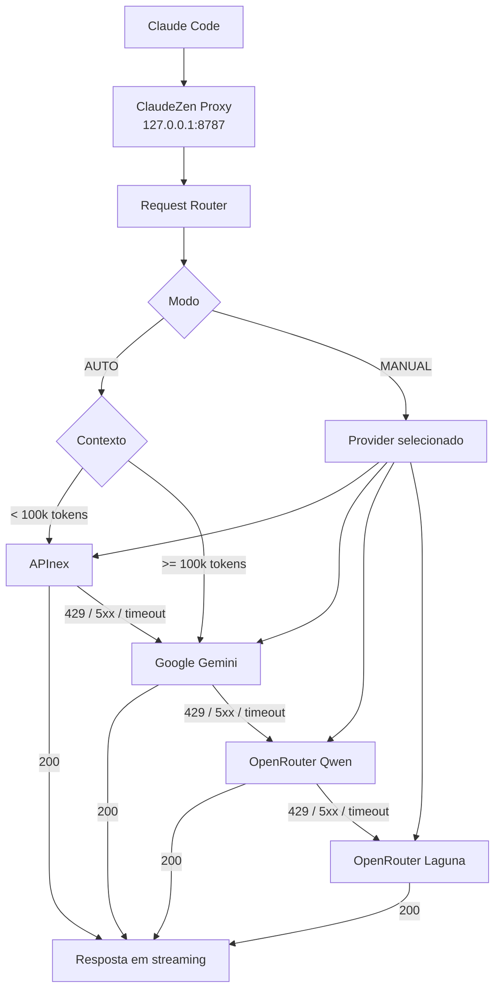

# ClaudeZen Hybrid Router

Proxy local para Claude Code com **roteamento híbrido entre múltiplos provedores de IA**, fallback automático, seleção manual de provider, cooldown, streaming em tempo real e **observabilidade por requisição** (estimativa local × uso real informado pelo provedor).

O Claude Code conversa somente com:

```text
http://127.0.0.1:8787
```

O ClaudeZen decide internamente qual provider e qual modelo serão utilizados.

> **Status do projeto: em desenvolvimento ativo.** A versão atual está operacional (AUTO, MANUAL, fallback, cooldown, streaming e observabilidade) e já suporta **vários providers por plataforma** (por exemplo, dois modelos do OpenRouter — Qwen e Laguna — como contingências independentes). A configuração genérica, a validação na inicialização, o menu dinâmico do switcher e os testes automatizados foram implementados e validados com upstream simulado. Permanece pendente o teste com **falha real** de um provedor. Detalhes na [seção 20 do relatório técnico](RELATORIO.md#20-pontos-a-melhorar-em-desenvolvimento).

---

## Arquitetura



---

# Características

* [x] Proxy local para Claude Code
* [x] Roteamento automático (AUTO) e manual (MANUAL)
* [x] APInex, Google Gemini e dois modelos do OpenRouter (Qwen e Laguna)
* [x] Configuração genérica: vários providers da mesma plataforma
* [x] Validação da configuração na inicialização
* [x] Menu do switcher dinâmico (gerado a partir do config.json)
* [x] Testes automatizados (`node --test`)
* [x] Fallback automático em cadeia
* [x] Cooldown por provider
* [x] Timeout por provider
* [x] **Streaming em tempo real** (sem bufferizar a resposta)
* [x] **Cancelamento propagado**: se o Claude Code desconectar, o upstream é abortado
* [x] **Observabilidade por requisição**: contexto, tools, roteamento, usage, tempo
* [x] **Uso real do upstream** comparado com a estimativa local
* [x] Banner de inicialização com checagem das API keys
* [x] Endpoint de status (`/router/status`)
* [x] Compatibilidade com a infraestrutura original do ClaudeZen
* [x] Zero dependências adicionais

---

# Providers

## APInex

```text
Base URL:
https://api.apinex.bond/v1

Modelo:
free/mimo-v2.6-pro
```

Provider principal no modo AUTO.

## Google Gemini

```text
Base URL:
https://generativelanguage.googleapis.com/v1beta/openai

Modelo:
gemini-3.8-flash
```

Usado preferencialmente para contextos grandes e como primeiro fallback.

## OpenRouter Qwen

```text
Base URL:
https://openrouter.ai/api/v1

Modelo:
qwen/qwen3.8-27b:free
```

Provedor de reserva no OpenRouter.

## OpenRouter Laguna

```text
Base URL:
https://openrouter.ai/api/v1

Modelo:
poolside/laguna-s-2.1:free
```

Provedor de reserva no OpenRouter, após o Qwen.

> Dois providers do OpenRouter compartilham o mesmo `baseUrl`, mas são entidades independentes: cada um tem `model`, `apiKeyEnv`, `name` e posição própria no `fallbackOrder`. O router os identifica pelo **ID** (`providers[id]`), não pela URL. Chaves diferentes da mesma conta podem compartilhar o limite dos modelos gratuitos do OpenRouter.

> Quer adicionar outro provider ou modelo? Veja [Como adicionar um novo provider ou modelo](#como-adicionar-um-novo-provider-ou-modelo).

---

## Como adicionar um novo provider ou modelo

Use este guia quando precisar:

- **Trocar ou adicionar uma IA de outra plataforma** (ex.: adicionar um provider da Together.ai).
- **Adicionar outro modelo de uma plataforma que já existe** (ex.: um terceiro modelo do OpenRouter).

Em ambos os casos, é um **novo provider independente**, com ID, `model` e `apiKeyEnv` próprios. Apenas o `baseUrl` pode se repetir (como acontece com os dois providers do OpenRouter).

### Requisito de compatibilidade

O ClaudeZen envia uma requisição **POST** para `{baseUrl}/chat/completions` (o `baseUrl` é normalizado: se não terminar em `/v1`, esse sufixo é adicionado automaticamente). O corpo da requisição e os headers seguem o formato da **API de Chat Completions da OpenAI** (`Authorization: Bearer <chave>`, `Content-Type: application/json`).

> **Limitação atual:** só há suporte a providers com API **compatível com a OpenAI**. Não existe adaptação de formato por provider. Se a plataforma usar um formato diferente, será necessário adaptar o `router.js` (fora do escopo deste guia).

Cada provider pode ter headers customizados opcionais via o campo `headers` (objeto), que são mesclados aos headers padrão.

### Passo a passo

1. **Escolha um ID único** para o provider. O ID é uma chave do objeto `providers` no `config.json` — não há validação de caracteres ou maiúsculas/minúsculas no código, mas use a [convenção de nomes](#convenção-de-nomes) abaixo.
2. **Adicione a entrada** em `providers` no `config.json` usando o [template](#template) abaixo.
3. **Adicione o ID ao `fallbackOrder`** na posição desejada. Se o provider não estiver no `fallbackOrder`, ele só poderá ser usado em modo **MANUAL** (e aparecerá um aviso na inicialização).
4. **Crie a variável de ambiente** da chave:
   ```powershell
   setx CLAUDEZEN_ID_DO_PROVIDER_API_KEY "SUA_CHAVE"
   ```
   Feche e abra um terminal novo para que a variável seja carregada.
5. **Reinicie o ClaudeZen.** O `config.json` é carregado uma única vez na inicialização, então qualquer alteração exige reinício. Confira o banner: o provider deve aparecer com `●` (chave detectada) ou `○` (chave ausente).
6. **Abra o `switcher.bat`.** O menu é gerado dinamicamente a partir do `config.json` (via `switcher-helper.js`), então o novo provider aparece automaticamente, sem alteração de código.
7. **Teste em modo MANUAL** selecionando o novo provider no menu e confirme em `/router/status` que ele foi usado.

### Template

```json
"id-do-provider": {
  "name": "Nome exibido",
  "baseUrl": "https://api.exemplo.com/v1",
  "model": "nome-do-modelo",
  "apiKeyEnv": "CLAUDEZEN_ID_DO_PROVIDER_API_KEY",
  "timeoutMs": 600000
}
```

| Campo | Obrigatório | Descrição |
| ----- | ----------- | --------- |
| `baseUrl` | Sim | URL base da API. Se não terminar em `/v1`, esse sufixo é adicionado. |
| `model` | Sim | Nome do modelo na plataforma. |
| `apiKeyEnv` | Sim | Nome da variável de ambiente que contém a chave. |
| `name` | Não | Nome exibido no banner e nos logs. Se ausente, usa o ID. |
| `timeoutMs` | Não | Timeout da requisição em ms. Padrão: `600000` (10 min) ou o valor de `upstreamTimeoutMs` do config. |
| `headers` | Não | Objeto com headers HTTP customizados para este provider. |

### Exemplo: adicionar um terceiro modelo do OpenRouter

Suponha um modelo fictício `meu-modelo-demo` no OpenRouter:

**1. Entrada em `providers`:**

```json
"openrouter-modelo-demo": {
  "name": "OpenRouter Modelo Demo",
  "baseUrl": "https://openrouter.ai/api/v1",
  "model": "meu-modelo-demo",
  "apiKeyEnv": "CLAUDEZEN_OPENROUTER_MODELO_DEMO_API_KEY",
  "timeoutMs": 600000
}
```

**2. Linha no `fallbackOrder`:**

```json
"fallbackOrder": ["apinex", "gemini", "openrouter-qwen", "openrouter-laguna", "openrouter-modelo-demo"]
```

**3. Variável de ambiente:**

```powershell
setx CLAUDEZEN_OPENROUTER_MODELO_DEMO_API_KEY "SUA_CHAVE"
```

### Convenção de nomes

> Recomendação, não regra imposta pelo código:

- **ID:** minúsculas com hífen, no formato `plataforma-modelo` (ex.: `openrouter-qwen`, `gemini`).
- **Variável de ambiente:** `CLAUDEZEN_<ID_EM_MAIÚSCULAS>_API_KEY` (ex.: `CLAUDEZEN_OPENROUTER_QWEN_API_KEY`).

O código não valida esses formatos — são apenas convenções para manter a consistência.

### Erros e avisos comuns

Mensagens reais do `validate-config.js` (executado na inicialização):

| Tipo | Mensagem | Ação |
| ---- | -------- | ---- |
| Erro | `Nenhum provider configurado: o objeto "providers" está ausente ou vazio no config.json.` | Adicione ao menos um provider em `providers`. |
| Erro | `Provider "<id>": a entrada não é um objeto válido no config.json.` | Verifique se a entrada do provider é um objeto JSON válido. |
| Erro | `Provider "<id>": o campo "baseUrl" está ausente ou vazio.` | Adicione o campo `baseUrl`. |
| Erro | `Provider "<id>": o campo "model" está ausente ou vazio.` | Adicione o campo `model`. |
| Erro | `Provider "<id>": o campo "apiKeyEnv" está ausente ou vazio.` | Adicione o campo `apiKeyEnv`. |
| Erro | `O campo "routing.fallbackOrder" deve ser uma lista não vazia de IDs de providers.` | Corrija o `fallbackOrder` para ser um array com ao menos um ID. |
| Erro | `"routing.fallbackOrder" contém um elemento inválido (esperado um ID de provider como string): <valor>.` | Use apenas strings (IDs) no `fallbackOrder`. |
| Erro | `"fallbackOrder" referencia o provider "<id>", que não existe em "providers".` | Remova o ID do `fallbackOrder` ou crie o provider correspondente. |
| Erro | `"routing.normalProvider" deve ser um ID de provider (string), recebeu: <valor>.` | Corrija `normalProvider` para ser uma string com um ID válido. |
| Erro | `"routing.normalProvider" aponta para o provider "<id>", que não existe em "providers".` | Use um ID que exista em `providers`. (Mesmo para `largeContextProvider`.) |
| Aviso | `"fallbackOrder" contém o ID "<id>" mais de uma vez. Entradas duplicadas são ignoradas.` | Remova a ocorrência duplicada. |
| Aviso | `Provider "<id>" está declarado em "providers", mas não aparece no "fallbackOrder". Ele será usado apenas em modo MANUAL.` | Adicione o ID ao `fallbackOrder` se quiser que ele participe do fallback automático. |

Além disso, se a variável de ambiente da chave não estiver definida:

- No **banner de inicialização**: o provider aparece com `○` e o aviso `⚠️  chave ausente: defina a variável <NOME>`.
- Em **tempo de requisição**: a chamada falha com status `500`, type `configuration_error` e mensagem `API key environment variable <NOME> is missing.`

### Checklist rápido

Antes de commitar, confira:

- [ ] ID único e sem conflito com providers existentes
- [ ] Entrada completa em `providers` (`baseUrl`, `model`, `apiKeyEnv`)
- [ ] ID adicionado ao `fallbackOrder` (se for participar do fallback automático)
- [ ] Variável de ambiente criada (`setx ...`) e terminal reiniciado
- [ ] Banner de inicialização mostra `●` para o novo provider
- [ ] Teste em modo MANUAL com o novo provider funciona
- [ ] `node --test` passa sem falhas
- [ ] Nenhuma chave de API real no repositório (use sempre `SUA_CHAVE`)

> **Atenção:** modelos gratuitos de uma mesma plataforma podem compartilhar o limite de requisições mesmo com chaves diferentes, se as chaves forem da mesma conta.

---

# Estrutura de arquivos

```text
ClaudeZen/
│
├── server.js
├── router.js
├── validate-config.js
├── config.json
├── switcher.bat
├── switcher-helper.js
├── routing-state.json
└── test/
```

| Arquivo              | Responsabilidade                                                                                                                              |
| -------------------- | --------------------------------------------------------------------------------------------------------------------------------------------- |
| `server.js`          | Servidor HTTP, conversão Anthropic ↔ OpenAI, streaming, endpoints, **apresentação dos logs**, integração com o router e validação na inicialização. |
| `router.js`          | Escolha do provider, estimativa de contexto, fallback, cooldown, timeout, modos AUTO/MANUAL, métricas de sessão. **Não imprime o debug amigável.** |
| `validate-config.js` | Validação centralizada da configuração (erros que abortam e avisos).                                                                          |
| `config.json`        | Providers e regras do router.                                                                                                                 |
| `routing-state.json` | Modo operacional atual (AUTO ou MANUAL), lido a cada requisição.                                                                              |
| `switcher.bat`       | Menu dinâmico de troca rápida de modo/provider.                                                                                                |
| `switcher-helper.js` | Lê o `config.json` para o menu do switcher e grava o `routing-state.json`.                                                                    |
| `test/`              | Testes automatizados (`node --test`).                                                                                                         |

Divisão de responsabilidades: **o router calcula; o server apresenta.** A estimativa de contexto, a divisão por categoria e a escolha do provider vêm do `router.js`; o `server.js` apenas formata e exibe, e traz o `usage` real que o provider informa no fim da resposta.

---

# Configuração

## 1. API Keys

As API keys **não** devem ser colocadas no `config.json`. Use variáveis de ambiente do Windows.

```powershell
setx APINEX_API_KEY "SUA_CHAVE"
setx GEMINI_API_KEY "SUA_CHAVE"
setx CLAUDEZEN_OPENROUTER_QWEN_API_KEY "SUA_CHAVE"
setx CLAUDEZEN_OPENROUTER_LAGUNA_API_KEY "SUA_CHAVE"
```

Depois abra um **novo** terminal e verifique:

```powershell
$env:APINEX_API_KEY
$env:GEMINI_API_KEY
$env:CLAUDEZEN_OPENROUTER_QWEN_API_KEY
$env:CLAUDEZEN_OPENROUTER_LAGUNA_API_KEY
```

> **Nota de migração:** a variável `OPENROUTER_API_KEY` **deixou de ser usada**. O OpenRouter agora tem duas chaves independentes: `CLAUDEZEN_OPENROUTER_QWEN_API_KEY` e `CLAUDEZEN_OPENROUTER_LAGUNA_API_KEY` (ambas podem apontar para a chave da sua conta OpenRouter).

> **Atenção:** chaves diferentes da mesma conta OpenRouter podem compartilhar o limite dos modelos gratuitos.

Ao iniciar, o ClaudeZen verifica se cada chave existe e mostra `●` (encontrada) ou `○` (ausente, com o nome da variável a definir).

**Nunca faça commit das API keys.**

## 2. Claude Code

```json
{
  "env": {
    "ANTHROPIC_BASE_URL": "http://127.0.0.1:8787"
  },
  "model": "qwen/qwen3.8-27b:free"
}
```

O modelo mostrado no Claude Code não precisa ser alterado: o router substitui internamente o modelo enviado ao upstream.

```text
Claude Code
qwen/qwen3.8-27b:free
       │
       ▼
ClaudeZen
       │
       ▼
APInex
free/mimo-v2.6-pro
```

## 3. Router

```json
{
  "routing": {
    "mode": "auto",
    "largeContextThreshold": 100000,
    "normalProvider": "apinex",
    "largeContextProvider": "gemini",
    "fallbackOrder": ["apinex", "gemini", "openrouter-qwen", "openrouter-laguna"],
    "cooldownSeconds": 300,
    "verbose": false
  }
}
```

`verbose` é opcional e controla os logs técnicos do router (veja [Logs](#logs)).

Se `fallbackOrder`, `normalProvider` ou `largeContextProvider` estiverem ausentes, o ClaudeZen os deriva dos providers no modo AUTO:

* `fallbackOrder` ausente → a ordem dos IDs em `providers`.
* `normalProvider` ausente → o primeiro provider.
* `largeContextProvider` ausente → o segundo provider (ou o primeiro, se só houver um).

A derivação é registrada com um aviso no log de inicialização.

---

# Modos de operação

## AUTO

```text
Contexto < 100.000 tokens   → APInex
Contexto >= 100.000 tokens  → Gemini

Fallback: APInex → Gemini → OpenRouter Qwen → OpenRouter Laguna
```

Cooldowns são respeitados: um provider em cooldown é pulado.

## MANUAL

O operador escolhe o provider e a escolha **tem prioridade sobre o cooldown**: o provider selecionado é sempre tentado primeiro. Se ele falhar, o restante da ordem de fallback é usado.

```text
switcher.bat
1 - AUTO
2 - APInex (apinex)
3 - Google Gemini (gemini)
4 - OpenRouter Qwen (openrouter-qwen)
5 - OpenRouter Laguna (openrouter-laguna)
6 - STATUS
0 - SAIR
```

O menu é gerado dinamicamente a partir do `config.json` pelo `switcher-helper.js`: um provider por opção, na ordem em que aparecem em `providers`. Se o `config.json` estiver inválido ou ilegível, o switcher mostra um erro claro e sai.

Trocar pelo switcher **não exige reiniciar** o servidor: o estado é lido na próxima requisição.

---

# Como iniciar

```powershell
cd C:\AI_config\ClaudeZen
node server.js
```

Deixe esse terminal aberto. Em outro terminal:

```powershell
claude
```

Banner de inicialização:

```text
════════════════════════════════════════════════════════════
                      CLAUDEZEN BRIDGE
════════════════════════════════════════════════════════════

   Status              : ✓ Online
   Endereço            : http://127.0.0.1:8787
   Config              : C:\AI_config\ClaudeZen\config.json
   Modo                : AUTO
   Limite contexto     : 100.000 tokens

🚦 PROVIDERS
   ● APInex       free/mimo-v2.6-pro  [normal]
   ● Google Gemini gemini-3.8-flash  [contexto grande]
   ○ OpenRouter Qwen qwen/qwen3.8-27b:free  [reserva]
       ⚠️  chave ausente: defina a variável CLAUDEZEN_OPENROUTER_QWEN_API_KEY
   ○ OpenRouter Laguna poolside/laguna-s-2.1:free  [reserva]
       ⚠️  chave ausente: defina a variável CLAUDEZEN_OPENROUTER_LAGUNA_API_KEY

   Fallback            : APInex → Google Gemini → OpenRouter Qwen → OpenRouter Laguna

   Aguardando requisições...  (Ctrl+C para encerrar)
════════════════════════════════════════════════════════════
```

Para encerrar, use **Ctrl+C**: o ClaudeZen salva o cache de reasoning, mostra o resumo da sessão e finaliza.

---

# Logs

Cada requisição ao Claude Code gera um bloco completo. Exemplo real (APInex, modo AUTO):

```text
════════════════════════════════════════════════════════════
                    CLAUDEZEN REQUEST #1
════════════════════════════════════════════════════════════

📦 CONTEXTO
   Payload             : 86.7 KB
   Tokens estimados    : ~22.194

   System              : ~6.237 tokens
   Messages            : ~347 tokens
   Tools               : ~15.579 tokens
   Other               : ~31 tokens

🧰 TOOLS
   Quantidade          : 25
   Maior               : SendMessage → ~1.435 tokens

🚦 ROTEAMENTO
   Modo                : AUTO
   Motivo              : NORMAL_CONTEXT
   Provider            : APInex
   Modelo              : free/mimo-v2.6-pro

🌐 REQUISIÇÃO
   Endpoint            : POST /v1/messages?beta=true
   Horário             : 00:15:51

📊 USAGE — REQUEST #1
   Input               : 22.457 tokens (upstream)
   Output              : 19 tokens (upstream)
   Total               : 22.476 tokens (upstream)

   Estimativa local    : ~22.194 tokens
   Diferença input     : +263 tokens

🌐 RESPOSTA
   Status              : 200 OK

⏱️ TEMPO
   Duração total       : 3,434 s

════════════════════════════════════════════════════════════
   ✓ USAGE CONFIRMADO PELO UPSTREAM
     Input + Output = 22.476 tokens
════════════════════════════════════════════════════════════

📈 SESSÃO
   Requests            : 1
   Estimado acumulado  : ~22.194 tokens
   Input (upstream)    : 22.457 tokens
   Output (upstream)   : 19 tokens
   Total (upstream)    : 22.476 tokens
   Fallbacks           : 0
   Erros               : 0
```

## Como ler

| Campo                        | Origem                                | Significado                                                                                  |
| ---------------------------- | ------------------------------------- | -------------------------------------------------------------------------------------------- |
| `Tokens estimados`           | Router (local)                        | Estimativa `bytes / 4` do payload. **Não** é a contagem do provider.                         |
| `System / Messages / Tools / Other` | Router (local)                 | Divisão da estimativa. A soma fecha exatamente com o total.                                  |
| `Input / Output / Total (upstream)` | Provedor                       | Uso real informado pelo provider na resposta. `Total` = `Input + Output`.                    |
| `Diferença input`            | Server                                | `Input (upstream) − Estimativa local`. Positivo: a estimativa ficou abaixo do real.          |
| `Duração total`              | Server                                | Da chegada da requisição ao fim da resposta. **Não** é latência de rede pura.                |

> O valor "(upstream)" é o uso informado pelo provedor, não necessariamente o que o provedor fatura ou o limite da sua quota.

## Avisos de fallback e cooldown

Sempre aparecem, independentemente do modo verbose:

```text
[03:23:22] ⚠️  APInex falhou (503) — acionando fallback
[03:23:22] 🧊 APInex em cooldown por 300s
[03:23:22] ⏭️  APInex pulado (em cooldown)
```

E o bloco da requisição indica `Fallback: SIM (N provider(s) falharam antes)`.

## Logs técnicos do router (opcional)

As linhas `[CONTEXT]`, `[ROUTE]`, `[PROVIDER]`, `[STATUS]` e `[ROUTER]` ficam **silenciosas por padrão**, pois o bloco acima já traz as mesmas informações. Para vê-las:

```powershell
$env:CLAUDEZEN_VERBOSE = "1"
node server.js
```

ou em `config.json`:

```json
{ "routing": { "verbose": true } }
```

Para depurar o `usage` bruto recebido do provider:

```powershell
$env:CLAUDE_OPENCODE_LOG_USAGE = "1"
```

> O nome `CLAUDE_OPENCODE_LOG_USAGE` é mantido por compatibilidade com a infraestrutura original do projeto.

---

# Streaming

O ClaudeZen repassa a resposta **em tempo real**: o primeiro token chega ao Claude Code assim que o provider começa a responder.

* O corpo da resposta não é bufferizado.
* O timeout e o cancelamento só são liberados quando o stream termina. Se o Claude Code desconectar no meio, o request upstream é abortado.
* O `usage` do stream chega no final e é contabilizado na sessão do router (`recordUsage`).

---

# Fallback

Falhas consideradas **recuperáveis** (acionam fallback e cooldown):

```text
408, 425, 429, 500-599
ETIMEDOUT, ECONNRESET, ECONNREFUSED, ECONNABORTED, ENOTFOUND, EAI_AGAIN
```

Demais erros (por exemplo 400) **não** acionam fallback e são devolvidos ao cliente.

```text
APInex ── 503 ──▶ Gemini ── 503 ──▶ OpenRouter Qwen ── 503 ──▶ OpenRouter Laguna ── 200 ──▶ Claude Code
```

## Cooldown

Após uma falha recuperável o provider entra em cooldown (padrão: **300 s**). No AUTO ele é pulado durante esse período; no MANUAL a escolha explícita do operador prevalece.

---

# Estimativa de contexto

O router não usa tokenizer específico de cada modelo:

```text
tokens ≈ bytes / 4
```

A estimativa serve para classificar a requisição como `NORMAL_CONTEXT` ou `LARGE_CONTEXT` e para a observabilidade. Em uma medição real com o APInex, a estimativa (22.194) ficou **263 tokens (1,2%) abaixo** do input informado pelo provider (22.457). O limite de `100.000` é um threshold operacional aproximado.

---

# Endpoint de status

```powershell
Invoke-RestMethod http://127.0.0.1:8787/router/status
```

```json
{
  "mode": "auto",
  "manualProvider": null,
  "thresholdTokens": 100000,
  "normalProvider": "apinex",
  "largeContextProvider": "gemini",
  "fallbackOrder": ["apinex", "gemini", "openrouter-qwen", "openrouter-laguna"],
  "providers": {
    "apinex": {
      "name": "APInex",
      "model": "free/mimo-v2.6-pro",
      "online": true,
      "requests": 2,
      "successes": 2,
      "failures": 0,
      "lastStatus": 200
    }
  }
}
```

`online` indica apenas que o provider **não está em cooldown** conforme o conhecimento do router; não há health check ativo.

---

# Segurança

* Não armazene API keys no `config.json`.
* Não faça commit de `.env` nem de arquivos com `sk-...` / `AIza...`.

```gitignore
routing-state.json
*.backup.js
*.backup.json
.env
.env.*
```

---

# Diagnóstico

```powershell
node --check router.js
node --check server.js
Invoke-RestMethod http://127.0.0.1:8787/router/status
Get-Content C:\AI_config\ClaudeZen\routing-state.json
```

| Sintoma                                   | Causa provável                                              |
| ----------------------------------------- | ----------------------------------------------------------- |
| `○` e "chave ausente" no banner           | Variável de ambiente não definida neste terminal.           |
| `HEAD /api/hello → 404`                   | Sondagem de conectividade do Claude Code. Inofensivo.       |
| Primeiro token demora alguns segundos     | Tempo do provider processando um contexto grande.           |
| `Fallback: SIM` no bloco                  | Um provider anterior da ordem falhou nesta requisição.      |

## Reiniciar ou não?

| Alteração                  | Reiniciar?                                       |
| -------------------------- | ------------------------------------------------ |
| `switcher.bat`             | Não. Vale na próxima requisição.                 |
| `config.json`              | Sim.                                             |
| `router.js` / `server.js`  | Sim (Ctrl+C e `node server.js`).                 |

---

# Validação da configuração na inicialização

Na inicialização, o ClaudeZen valida o `config.json` (centralizado em `validate-config.js`). A falha (**erro**) impede a subida do serviço, com `process.exit(1)` e mensagem clara em português.

## Erros (abortam a inicialização)

| Verificação                                      | Mensagem (resumo)                                                                 |
| ------------------------------------------------ | --------------------------------------------------------------------------------- |
| `providers` ausente ou vazio                     | `Nenhum provider configurado: o objeto "providers" está ausente ou vazio...`       |
| ID no `fallbackOrder` inexistente em `providers` | `"fallbackOrder" referencia o provider "X", que não existe em "providers".`        |
| `normalProvider` apontando para ID inexistente   | `"routing.normalProvider" aponta para o provider "X", que não existe...`           |
| `largeContextProvider` → ID inexistente          | `"routing.largeContextProvider" aponta para o provider "X", que não existe...`     |
| Provider sem `baseUrl`                           | `Provider "X": o campo "baseUrl" está ausente ou vazio.`                           |
| Provider sem `model`                             | `Provider "X": o campo "model" está ausente ou vazio.`                             |
| Provider sem `apiKeyEnv`                         | `Provider "X": o campo "apiKeyEnv" está ausente ou vazio.`                         |
| `fallbackOrder` ausente/vazio ou não-lista       | `O campo "routing.fallbackOrder" deve ser uma lista não vazia...`                  |

## Avisos (não abortam)

| Verificação                                       | Efeito                                                                 |
| ------------------------------------------------- | ---------------------------------------------------------------------- |
| Variável de ambiente da chave não definida        | Exibida no banner no início (chave ausente). O serviço continua.        |
| ID duplicado no `fallbackOrder`                   | Duplicatas são ignoradas na ordem de fallback.                          |
| Provider declarado mas fora do `fallbackOrder`    | Só fica acessível no modo MANUAL.                                       |

---

# Testes

Sem dependências externas (usa apenas o runner nativo `node --test`):

```powershell
node --test
```

Cobre roteamento, validação da configuração, derivação do `fallbackOrder`, fallback em cadeia, cooldown, modo MANUAL e o envio do modelo correto quando dois providers compartilham o mesmo `baseUrl`. Os providers de roteamento são **upstreams HTTP locais simulados** em `127.0.0.1` (portas livres), sem tocar em chaves reais.

Para checar apenas o arquivo novo:

```powershell
node --test test/generic-providers.test.js
```

O pacote já define `"test": "node --test"` no `package.json`, então `npm test` também funciona. Para apontar o servidor para outro `config.json`, use `CLAUDEZEN_CONFIG` (ou `CLAUDE_OPENCODE_PROXY_CONFIG`, ou `--config`), ex.:

```powershell
$env:CLAUDEZEN_CONFIG = "C:\tmp\meu-config.json"
node server.js
```

---

# Validação

| Cenário                                                        | Ambiente              | Resultado |
| -------------------------------------------------------------- | --------------------- | --------- |
| Sintaxe (`node --check`)                                       | Local                 | ✅        |
| AUTO → APInex, requisição real pelo Claude Code                | **Provider real**     | ✅        |
| MANUAL → Gemini                                                | **Provider real**     | ✅        |
| Retorno para AUTO                                              | **Provider real**     | ✅        |
| Usage upstream × estimativa                                    | **Provider real**     | ✅ (+1,2%)|
| Streaming em tempo real                                        | Upstream simulado     | ✅        |
| Cancelamento do cliente propagado ao upstream                  | Upstream simulado     | ✅        |
| Fallback APInex 503 → Gemini 200                               | Upstream simulado     | ✅        |
| Cadeia APInex 503 → Gemini 503 → OpenRouter 200                | Upstream simulado     | ✅        |
| Cadeia completa 503 → 503 → 503 → 200 (4 providers)            | Upstream simulado     | ✅        |
| Provider em cooldown é pulado no AUTO                          | Upstream simulado     | ✅        |
| MANUAL ignora cooldown                                         | Upstream simulado     | ✅        |
| Mesmo `baseUrl` com modelos diferentes envia o model correto   | Upstream simulado     | ✅        |
| Validação da configuração (abort na inicialização)             | Upstream simulado     | ✅        |
| Derivação do `fallbackOrder` quando ausente                    | Upstream simulado     | ✅        |
| Fallback com falha real de provedor (429/5xx reais)            | Provider real         | ⏳ pendente |

---

# Limitações

* **Falha no meio do stream:** se um provider já começou a transmitir e cai no meio, o router não consegue transferir a mesma resposta para outro provider. O fallback é confiável antes do início do stream.
* **Estimativa de tokens aproximada:** não equivale ao tokenizer do modelo.
* **Quotas:** o router não conhece o saldo real de cada provider; trabalha com requests, sucessos, falhas e cooldown.
* **Usage da rota `/v1/chat/completions`:** o corpo é repassado sem leitura, então essa rota não registra usage.
* **Latência média no stream:** a `averageLatencyMs` do router, nas requisições em stream, mede o tempo até a resposta começar.

---

# Roadmap

```text
[x] Contagem real de tokens (usage informado pelo upstream)
[x] Streaming em tempo real
[x] Observabilidade por requisição
[x] Configuração genérica: vários modelos da mesma plataforma
[x] Validação da configuração na inicialização
[x] Menu do switcher gerado a partir do config.json
[x] Limpeza de resquícios do projeto original
[x] Testes automatizados (`node --test`)
[ ] Circuit breaker completo
[ ] Health checks ativos
[ ] Retry-After
[ ] Rate-limit headers
[ ] Controle de quota
[ ] Dashboard web
[ ] Métricas persistentes
[ ] Histórico de requests
[ ] Pesos por provider
[ ] Estratégias de custo / por modelo
[ ] Mais providers
```

---

# Filosofia

```text
Claude Code não precisa conhecer o provider.
```

Ele conhece apenas `127.0.0.1:8787`. O ClaudeZen conhece os providers. O router sabe qual utilizar, quando evitar e quando fazer fallback. Isso permite trocar o backend de IA sem alterar o fluxo do Claude Code.

---

## Licença

Consulte a licença original do projeto ClaudeZen antes de redistribuir modificações ou publicar alterações derivadas.
